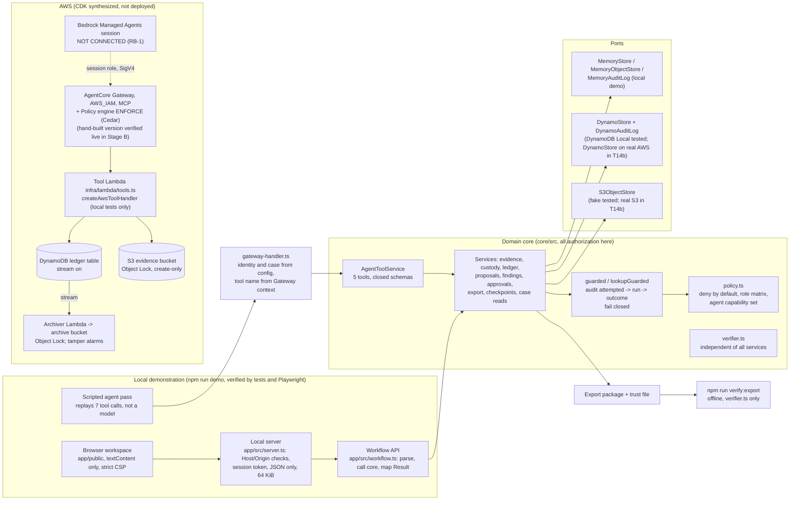

# Architecture

Status, November 18, 2026: the domain core, the local investigation workspace and the AWS adapters are built and tested. The CDK app is synthesized and tested, **not deployed**. The Bedrock Managed Agents (BMA) runtime is **not connected**: the account has no access (release blocker RB-1). Each box below is labeled with how far it has been verified.

## Components



## Trust boundaries

| Boundary | What crosses it | Control |
|---|---|---|
| Browser to local server | Persona choice, form input | Host and Origin checks, per-launch session token (constant-time compare), JSON only with a size limit. Identity is a **demo control** (no login): a deployment needs real authentication |
| Workflow API to core | A `RequestContext` and the request body | The core authorizes and audits every call; the API makes no decisions |
| Agent to Gateway | MCP tool calls signed by the BMA session role | IAM `InvokeGateway` on one gateway; Cedar boundary admits only the session role; per-tool permits with argument constraints |
| Gateway to tool Lambda | Tool name in client context, arguments in the event | Identity and case are deployment configuration; arguments are untrusted and checked again by closed schemas and the core |
| Tool Lambda to storage | Conditional writes, exact-version reads | Least-privilege role: no delete, no update in place, no evidence writes |
| Export to recipient | Package, plus a trust file by a separate channel | Offline verifier trusts only the supplied public key and reference head |

## What each verification level means

| Label | Meaning |
|---|---|
| Local demonstration | Runs on this machine with in-memory adapters; proves behavior of the code, not of AWS |
| DynamoDB Local / S3 fake | Real AWS SDK requests against DynamoDB Local, or against an in-memory bucket behind the real S3 client; proves request shape and error handling, not the AWS service |
| Verified on AWS | Ran against real AWS resources, with results recorded: Stage B Gateway and Cedar (T09B), storage adapters and IAM denies (T14b) |
| Synthesized | CDK produces a template that passes the template tests; nothing deployed |
| Scripted agent | Fixed tool calls replayed through the real handler; **not a model** and not BMA evidence |

Details: [ADR 0003](adr/0003-bma-integration-and-enforcement-layers.md) (enforcement layers), [ADR 0005](adr/0005-domain-core.md) (core), [ADR 0007](adr/0007-aws-storage-adapters.md) and [ADR 0008](adr/0008-ledger-overwrite-risk.md) (storage), [ADR 0009](adr/0009-investigation-workspace.md) (workspace), [runbook](runbooks/infra.md) (deploy and teardown).

---

## Planning notes (November 2026, kept for history)

The sections below are the original design notes. Where they differ from the code, the code and the ADRs above win; they are kept because they record why the design looks the way it does.

Status: design only. The local Mozaik collaboration harness is separate from the future evidence application.

### Components and trust boundaries

```text
Investigator browser -> authenticated application API -> deterministic policy service
                                      |                   |
                                      |                   +-> evidence reader (exact version)
                                      |                   +-> ledger / approvals / security audit
                                      +-> single Managed Agent -> narrow tool gateway -> same policy

Original store (agent cannot write) -> version-pinned derived views -> agent context
Ledger + exact-version files -> export builder -> independent verifier
Protected checkpoint store <- ledger snapshots (separate writer authority)
```

Start with a TypeScript domain core and local filesystem/SQLite adapters for reproducible synthetic tests. Local storage simulates interfaces, not AWS immutability. React is the planned UI. Keep the core independent of provider SDKs. No new libraries or app scaffold are installed in this setup.

Update November 18, 2026: ADR 0003 (adopted) replaces the agent path above. BMA runs the Codex harness, and the agent has a shell in its execution environment. The narrow tool boundary is an AgentCore Gateway with Policy (Cedar) in ENFORCE mode and Lambda targets, called by BMA with the session role. The execution environment holds no credentials or evidence. The Gateway sees the agent's session role, not a human, so the agent is its own case-bound principal. See ADR 0003 for storage enforcement (conditional-write bucket policies, DynamoDB transactional ledger, separate checkpoint bucket).

Earlier target AWS mapping, kept for history: Cognito identities; API Gateway and Lambda for the API and policy; S3 versioning/Object Lock for originals and separately protected checkpoints; DynamoDB for case index, conditional ledger writes and approvals; CloudTrail for selected AWS API activity and CloudWatch for operations. CloudTrail is not a replacement for business-level security events. Bedrock Managed Agents is the intended integration, not interchangeable with another agent product. Check current supported tool mechanisms and region/runtime availability before choosing its adapter. No AWS resources exist for this repository.

### Domain model and contracts

Review resolution: use one sequence/hash chain per case, not competing per-evidence chains. Evidence IDs link each event to an artifact. Sequence defines order; server time is context and can move backward. A Correction is a new event referencing exact target sequence/hash in the same case. Preserve original and correction; any effective view is a labeled interpretation.

Trusted execution context distinguishes human identity, optional agent identity and execution channel. Agent effective permission is the intersection of current human/case permissions and narrower agent capabilities. Reads and validated reports are allowed through the gateway. Restricted mutations create Proposal drafts only. An authenticated human promotion re-runs policy; the draft cannot advance the custody ledger itself. HistoricalAssertion is distinct from a contemporaneous transfer and references existing pinned evidence, raw claimed time, source clock, timezone and offset uncertainty.

Case: id and membership. Evidence: caseId, evidenceId, original storage key, exact versionId, SHA-256, size, media type, registrar and recordedAt. DerivedEvidence: exact parent reference, transformation, resulting hash. CustodyEvent: caseId/evidenceId, monotonic sequence, server time, authenticated actor, action, source/destination, reason, prior hash and event hash. Preserve claimed historical time separately from server-recorded time. Approval: immutable request digest, requester, independent approver, scope, expiration, one-time consumption. Finding: pinned references, method, expected/actual hash, status and uncertainty. SecurityEvent: request/correlation ID, actor, decision and reason.

Proposed API: GET /cases/:id/evidence; GET /cases/:id/evidence/:eid/versions/:vid; POST /cases/:id/audits; POST /cases/:id/custody-events; POST /cases/:id/corrections; POST /cases/:id/approvals; POST /cases/:id/exports. There is no API to rewrite an original or delete ledger history. Return stable error codes and a correlation ID. Resolve identity from a verified session, never model-supplied actor fields. Check case scope on every read and write.

### Integrity and concurrency

Register by staging bytes, computing SHA-256, sealing a specific version and committing metadata only after storage confirmation. Failed registration leaves quarantined staging, not registered evidence. Never read the current/latest alias as an original. Handle missing versions as verification failure.

Use canonical event serialization (schema version, explicit fields, normalized encodings, stable order), per-case/evidence sequence and conditional compare-and-set on the ledger head. Two concurrent appends cannot both succeed at the same sequence. Commit approval consumption, event insertion and head update atomically. Idempotency keys are bound to authenticated actor, case and request digest. Duplicate identical requests return the original result; different payloads with the same key fail.

Hash chains detect edits only if the verifier trusts a separately protected checkpoint. An administrator who can rewrite all events and their checkpoints can forge the whole chain. Exports must include an authenticated checkpoint, sequence count/head, pinned manifest and referenced bytes. The verifier checks hashes, linkage, order and checkpoint coverage, including suffix truncation. It reports unanchored tails and cannot prove facts were true at collection. A hash is a fingerprint, not proof of origin.

Verifier trust comes from a pinned public key and a case-bound checkpoint reference supplied outside the package. Include expected minimum sequence and reference retrieval time when available. Never accept the package's own key as its trust root. Report valid-through-N, missing anchored history, unanchored tail, invalid signature, wrong case or unknown freshness separately. An older valid checkpoint is not detectable as stale without a newer trusted reference. Same-host signer separation is a simulation unless key access and signing policy are independently enforced. The exact signing/canonicalization contract and golden vectors are the next spec task, not implemented controls.

Treat every MVP export as restricted. A database transaction creates one durable ExportOperation and consumes approval exactly once. Use private staging and a recoverable state machine: authorized -> staging -> verified -> ready, or failed. Downloads require both committed ready state and current read authorization. Retries recover the same logical operation; do not promise exactly one filesystem write. Test crash boundaries around approval consumption, staging and readiness. Security outcomes use attempted/denied/failed/completed plus correlation IDs; a denied overwrite never creates a custody transfer. Security logs also need checkpoint anchoring, not just inclusion in an export.

### Failure behavior and constraints

Fail closed on unavailable identity/policy/approval/audit persistence, malformed requests or missing evidence. Keep denials outside the custody ledger but inside the security audit. Restrict previews and exports to allowlisted types, sizes and paths; treat evidence as hostile text. Audit reports cite data; unsupported claims fail validation.

If the audit store itself is unavailable, return DENIED_AUDIT_UNAVAILABLE and make no protected mutation. Emit a best-effort operational diagnostic, but do not claim a denial was persisted in an unavailable store. Ordinary successful database mutations need transactional outcome records; filesystem outcomes need the recoverable operation state above.

MVP load is one synthetic case, 10 initial artifacts, one agent and a few local users. No distributed queue needed initially. Revisit durable delivery, independent checkpoint signing/custody, backup restore, tenancy isolation and rate limiting before production. AWS Object Lock mode/retention and cleanup must be explicitly chosen before provisioning; never default to long irreversible retention.
